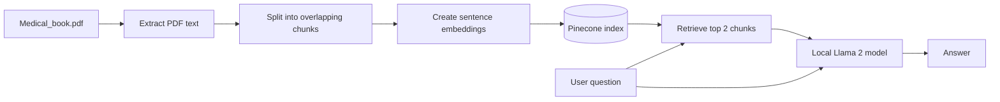

# Medical Knowledge Chatbot

> **This project is for educational purposes and is not medical advice.**

A Flask chat app that answers questions using information retrieved from a bundled medical reference PDF and a local Llama 2 model.

## The problem it solves

Medical reference books can be difficult to search when someone needs a quick pointer to relevant information. This project demonstrates a chat-style way to search one medical PDF and get a response based on the passages found. It is a learning project, not a clinical or business-ready medical service.

## Key features

- Loads the PDF in `data/` and extracts its text.
- Splits the text into overlapping 500-character chunks.
- Creates embeddings with the `sentence-transformers/all-MiniLM-L6-v2` model and stores them in Pinecone.
- Retrieves the two most relevant chunks for a question.
- Uses a local Llama 2 7B model through CTransformers to draft an answer from the retrieved context.
- Provides a basic Flask chat page.

## How it works

1. Run the index-building script to read `data/Medical_book.pdf`.
2. The script splits the PDF text into chunks, embeds them, and writes them to the Pinecone index.
3. Start the Flask app and submit a question in the chat page.
4. The app retrieves the two closest chunks and passes them with the question to the local Llama 2 model.
5. The generated response is returned to the page.



## Tech stack

- Python
- Flask
- LangChain and LangChain Pinecone
- Pinecone vector database
- CTransformers with a local Llama 2 7B GGML model
- Hugging Face Sentence Transformers (`all-MiniLM-L6-v2`)
- PyPDF
- HTML and CSS

## Project structure

```text
.
├── app.py                 # Flask routes and retrieval-and-answer chain
├── store_index.py         # Build the Pinecone index from the bundled PDF
├── src/
│   ├── helper.py          # PDF loading, chunking, and embedding setup
│   └── prompt.py          # Prompt template used for grounded answers
├── data/
│   └── Medical_book.pdf   # Source document indexed by the project
├── model/                 # Place the downloaded Llama 2 model here (ignored by Git)
├── templates/chat.html    # Chat page
├── static/style.css       # Chat page styles
├── research/trails.ipynb  # Notebook exploring the retrieval workflow
├── requirements.txt       # Python dependencies
└── .env.example           # Environment variable names and placeholders
```

## Setup and run

Use Python 3.10 in a virtual environment. From the repository root:

```bash
python -m venv .venv
# macOS/Linux
source .venv/bin/activate
# Windows PowerShell: .venv\Scripts\Activate.ps1
python -m pip install --upgrade pip
pip install -r requirements.txt
```

Copy `.env.example` to `.env` and set your own Pinecone credentials. The required variable names are `PINECONE_API_KEY` and `PINECONE_API_ENV`. `LLM_MODEL_PATH` is optional; when omitted, the app looks for `model/llama-2-7b-chat.ggmlv3.q4_0.bin`.

Download a compatible Llama 2 7B GGML model file, create the `model/` directory, and place the file at the default path above (or set `LLM_MODEL_PATH` to its location). The model is large and is not included in this repository.

Build or refresh the Pinecone index, then launch the app:

```bash
python store_index.py
python app.py
```

Open <http://127.0.0.1:8080>. Indexing requires access to Pinecone and the configured credentials. Installing Python packages and downloading/loading the local model may take time and disk space.

## Demo


Live demo: <ADD LINK HERE>  
Demo video: <ADD LINK HERE>

## Limitations and future improvements

- This is an educational example; answers can be incomplete or incorrect and must not guide medical decisions.
- The index currently uses one bundled PDF and retrieves only two chunks; there is no document upload or source citation UI.
- The local 7B model requires a separate large model file and suitable machine resources.
- Add automated tests, clearer error handling, and a complete chat response-rendering flow before using this as a polished deployed app.

## Author

**Divyani Patel**  
LinkedIn: <ADD LINK HERE>  
Kaggle: <ADD LINK HERE>
